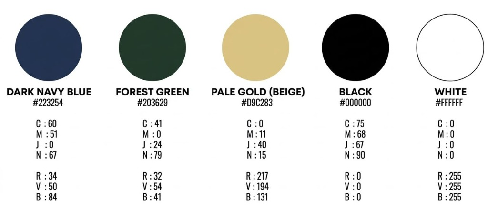

# Project Brand Color System

This skill contains the official brand color palette for Ariadne. Always consult this palette when creating, updating, or styling any UI elements, pages, components, and media across the website to maintain strict visual brand consistency.

---

## Official Brand Palette

The project is defined by a 5-color palette specified below with exact HEX, RGB, and CMYK color codes:

### 1. Dark Navy Blue
* **Name**: Dark Navy Blue
* **HEX**: `#223254`
* **RGB**: `rgb(34, 50, 84)`
* **CMYK**: `C: 60 | M: 51 | J(Y): 0 | N(K): 67`
* **Role**: Primary brand color, dark surface backgrounds, hero sections, primary headers, deep container themes.

### 2. Forest Green
* **Name**: Forest Green
* **HEX**: `#203629`
* **RGB**: `rgb(32, 54, 41)`
* **CMYK**: `C: 41 | M: 0 | J(Y): 24 | N(K): 79`
* **Role**: Secondary deep brand tone, nature/cinematic thematic accents, secondary dark badges, subtle contrast surfaces.

### 3. Pale Gold (Beige)
* **Name**: Pale Gold (Beige)
* **HEX**: `#D9C283`
* **RGB**: `rgb(217, 194, 131)`
* **CMYK**: `C: 0 | M: 11 | J(Y): 40 | N(K): 15`
* **Role**: Primary accent color, CTA buttons, active state indicators, highlight text, borders, decorative badges, warm luxury details.

### 4. Black
* **Name**: Black
* **HEX**: `#000000`
* **RGB**: `rgb(0, 0, 0)`
* **CMYK**: `C: 75 | M: 68 | J(Y): 67 | N(K): 90`
* **Role**: Structural color, solid dark backgrounds, high-contrast dark elements, primary text on light surfaces.

### 5. White
* **Name**: White
* **HEX**: `#FFFFFF`
* **RGB**: `rgb(255, 255, 255)`
* **CMYK**: `C: 0 | M: 0 | J(Y): 0 | N(K): 0`
* **Role**: Structural color, clean backgrounds, cards on dark backgrounds, primary text on dark navy or black surfaces.

---

## CSS Variables Quick Reference

```css
:root {
  --color-dark-navy: #223254;
  --color-forest-green: #203629;
  --color-pale-gold: #D9C283;
  --color-black: #000000;
  --color-white: #FFFFFF;

  /* Semantic UI mappings */
  --brand-primary: var(--color-dark-navy);
  --brand-secondary: var(--color-forest-green);
  --brand-accent: var(--color-pale-gold);
  --brand-surface-dark: var(--color-dark-navy);
  --brand-surface-light: var(--color-white);
  --brand-text-dark: var(--color-black);
  --brand-text-light: var(--color-white);
}
```

---

## Rules for Maintaining Color Consistency

1. **Strict Palette Adherence**: Exclusively use the colors listed above. Do not introduce arbitrary shades of blue, green, or gold without explicit request.
2. **Contrast & Legibility**: 
   - When using **Dark Navy Blue (`#223254`)**, **Forest Green (`#203629`)**, or **Black (`#000000`)** as a background, ensure text and critical icons use **White (`#FFFFFF`)** or **Pale Gold (`#D9C283`)** for high contrast.
   - When using light surfaces (e.g. **White (`#FFFFFF`)** or subtle light tints), use **Black (`#000000`)** or **Dark Navy Blue (`#223254`)** for readable typography.
3. **Accent Hierarchy**: Use **Pale Gold (`#D9C283`)** purposefully to draw attention to call-to-actions, active navigation states, key highlights, and luxury accent details.
4. **Logo Visibility**: Ensure the appropriate logo variant is chosen depending on the surface:
   - On light backgrounds: Use the dark text logo (`/mylogo.png`).
   - On dark navy / black backgrounds: Use the white text logo (`/mylogo-white.png`).
5. **No Clashing Combinations**: Avoid putting Dark Navy Blue and Forest Green directly on top of each other without a high-contrast dividing line or Pale Gold accent.

---

## Visual Reference

